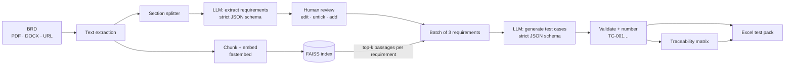

# 🧪 AI Test Case Generator

Turn a Business Requirements Document into **traceable, ready-to-run test cases**, exported as an Excel test pack.

**[Live demo](https://apptestcasegenerator.streamlit.app/)** · Python · Groq (GPT-OSS 120B) · FAISS · fastembed · Streamlit

---

## What it does

1. **Load a BRD** as PDF, Word, text or a public URL. A sample BRD is built in.
2. **Extract requirements.** The LLM reads the whole document section by section and lists every testable requirement, keeping the BRD's own IDs (e.g. `FR-03`) and a verbatim source quote. You review, edit, untick or add requirements before anything is generated.
3. **Generate test cases per requirement.** For each batch of requirements, the passages of the BRD that describe them are retrieved with FAISS and passed to the model as context (RAG), so test cases use the document's real rules and values.
4. **Download an Excel test pack** with four sheets:
   - **Test Cases**: ID, linked requirement, type, priority, preconditions, numbered steps, test data, expected result, plus *Status* (dropdown) and *Actual Result* columns for execution
   - **Traceability**: requirement → test case IDs, types covered, coverage flag
   - **Requirements**: each requirement with its source quote from the BRD
   - **Summary**: live formulas for coverage and pass/fail counts as testers fill in results

## How it works



### Design decisions

| Problem | Approach |
|---|---|
| A single similarity search only sees a few chunks, so most of a long BRD gets no tests | Extract requirements across the **whole** document first, then retrieve context **per requirement** |
| Free-text LLM output is fragile to parse | Groq **strict JSON-schema** structured output, validated with Pydantic. No regex parsing |
| LLMs invent features | Prompts restrict tests to the retrieved context; test cases pointing at unknown requirement IDs are dropped |
| Hard to trust AI output | Human review step, source quotes for every requirement, traceability matrix |
| Free-tier rate limits | Small batches, automatic retry with backoff on HTTP 429, a lighter 20B model option |
| Uploaded docs may contain prompt-injection text | Document content is fenced and the model is told to treat it as data |
| Public demo fetching arbitrary URLs | Only public http(s) hosts; localhost and private networks are blocked |

## Run locally

```bash
git clone https://github.com/samramkumarqa/GenerativeAI.git
cd GenerativeAI
python -m venv .venv && source .venv/bin/activate
pip install -r requirements.txt

cp .env.example .env          # then paste your free key from https://console.groq.com/keys
streamlit run main.py
```

The first run downloads a small embedding model (~70 MB), then caches it.

## Deploy on Streamlit Community Cloud

1. Point the app at `main.py` on this repo.
2. In **App settings → Secrets**, add:
   ```toml
   GROQ_API_KEY = "gsk_..."
   ```
   If no key is configured, visitors are asked to paste their own.

## Tests

```bash
pip install -r requirements-dev.txt
pytest
```

The suite runs offline: a fake LLM and a hashing embedder stand in for Groq and the embedding model. It covers document loading, URL safety checks, requirement de-duplication and ID assignment, retrieval, batching and filtering of generated tests, the traceability matrix, the Excel workbook structure, and a full click-through of the Streamlit UI.

## Project structure

```
main.py                 Streamlit UI
tcgen/
  loaders.py            PDF / DOCX / TXT / URL → text
  rag.py                chunking, embeddings, FAISS index
  llm.py                Groq client with structured output
  pipeline.py           requirement extraction, test generation, traceability
  export.py             Excel workbook
  schemas.py            Pydantic models
  config.py             models, chunk sizes, test types
samples/sample_brd.pdf  fictional BRD for the demo
scripts/                regenerates the sample BRD
tests/                  offline test suite
```

## Limitations

- Scanned PDFs need OCR first; only text-based documents are read.
- Output quality depends on how clearly the BRD states its rules. Always review generated tests.
- Documents are sent to Groq for processing. Don't upload confidential material to the public demo.
